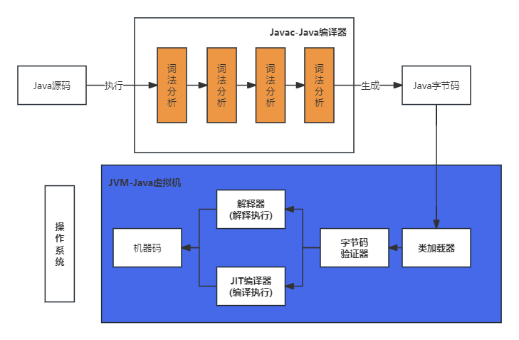

# 复习
# 面试
###1. 一个”java”源文件中是否可以包括多个类？有什么限制（明*数据)
   * 可以，但只能有一个public修饰的类，且public的类名必须与源文件名相同
###2. Java的优势（阿*巴）
   * 跨平台性：通过不同平台的JVM可以做到，`一次编译到处运行`
   * 面向对象：基于面向对象的特性，使得的其适合大型软件的开发
   * 健壮性：GC的存在很大程度上避免的内存管理，提高的程序健壮性
   * 安全性高：据说通过类加载器可以防止代码攻击，但是体会不是很深刻
   * **社区繁荣:各种框架层出不穷，各种开源库，各种优秀的解决方案**
    
###3. 常用的几个命令行操作都有哪些？（至少4个）（北京数字*）  
   * window:dir、cd、md、rd、del、copy、xcopy、ren、findstr  
   * linux:ls、cd、pwd、mkdir、rm、mv、cp、cat、more、less、grep、find
###4. Java中是否存在内存溢出、内存泄漏？如何解决？举例说明（拼*多）

   * 存在，比如死锁、死循环等都有可能导致内存溢出(不断地创建变量)，防止写这种代码
     
   * 存在，比如String常量池、对象引用等都有可能导致内存泄漏

   * 存在，比如项目中需要加载的类的数量超过了java虚拟机装载类的空间，配置Permanent Generation space的大小
     
     ``
     -XX:PermSize=64M 
     -XX:MaxPermSize=128m
     ``

###5. 如何看待Java是一门半编译半解释型的语言（携*）

* 解释型语言：逐行将源代码翻译成机器码，再由机器执行
* 编译型语言：一次性将源代码翻译成机器码，再由机器执行
  
**我的理解：Java的半编译半解释是指的在JVM中执行字节码时，可能是解释器进行解释执行，也可能是JIT编译器进行编译执行。**
也有人觉得在源代码通过Java编译器编译成字节码的时候体现了编译性，但是我觉得还是在执行阶段最能够体现编译和解释的特性

Java 被称为“半编译半解释型语言”，这是因为它采用了一种**混合型的执行方式**，结合了编译执行和解释执行的特点。这种方式通过将源代码先编译成**字节码**（中间代码），然后在不同的虚拟机环境中进行解释和/或即时编译（JIT）来执行。具体来说，Java 的执行过程如下：

1. **源代码编译**：Java 源代码（.java 文件）首先通过 Java 编译器（`javac`）编译成一种称为**字节码**的中间表示形式（.class 文件）。字节码是平台无关的，不依赖于具体的硬件或操作系统。
2. **字节码解释执行或JIT编译**：Java 字节码并不是直接在操作系统上执行的，而是由 Java 虚拟机（JVM）来执行。JVM 的工作方式有两种：
    - **解释执行**：JVM 可以逐行解释执行字节码，将其转化为对应平台的机器代码，实时执行。解释执行的过程是逐行进行的，速度较慢。
    - **即时编译（JIT）**：为了提高性能，JVM 引入了**即时编译（JIT）技术**，在程序运行过程中，***JVM 会将部分热点代码（即经常执行的代码）动态地编译成机器代码，从而加速执行***。
**在Java中JVM可以选择是解释执行还是JIT编译执行，默认是解释执行，但是可以通过参数指定是编译执行还是解释执行**

###6. JVM为什么默认是解释执行而不是编译执行？（携*多）
**解释执行的优势在于它可以更快地启动应用程序，因为无需等待即时编译的完成。**
然而，解释执行的性能相对较低，因为它不会将字节码转换为本地机器代码，而是每次执行都需要解释一次。

随着应用程序的运行，Java虚拟机可能会使用即时编译器（Just-In-Time Compiler，JIT）来提高性能。
JIT编译器将热点代码（在运行时频繁执行的代码）编译成本地机器代码，以加速这部分代码的执行。
这样，JVM可以在运行时动态地选择何时以及对哪些代码进行即时编译，以优化性能。

需要注意的是，JVM的实现可能有不同的配置和优化策略，因此在某些情况下，可能会选择不同的默认执行方式。
然而，通常情况下，解释执行是Java虚拟机的默认执行方式。

#注释：编译执行和解释执行

### 1. 编译执行（Compilation）

**编译执行**是将源代码一次性翻译成目标机器语言（通常是二进制的可执行文件）的一种方式。这个过程是通过编译器（compiler）完成的。
编译器会将整个源代码文件读取进来，分析和优化后，**生成一个可执行文件，然后用户可以直接运行这个可执行文件**。

#### 编译执行的流程：

1. **源代码**（高级语言代码）由编译器读取。
2. 编译器进行**语法分析**、**优化**等处理，将源代码转化为**中间代码**或**机器代码**（如可执行文件）。
3. 用户直接运行生成的机器代码，不再需要源代码。

#### 优点：

- **执行效率高**：编译后的程序直接生成机器代码，执行速度非常快。
- **独立性**：编译后的程序可以在没有源代码的情况下运行，不需要编译器支持。
- **优化空间大**：编译器在编译阶段可以进行多种优化，生成高效的机器代码。

#### 缺点：

- **编译时间长**：程序需要经过编译阶段，编译过程可能比较慢，尤其是对于大型程序。
- **调试困难**：调试时需要重新编译，无法像解释执行那样逐行执行代码来查找问题。
- **平台依赖性**：编译生成的机器代码通常是针对特定平台的，不同平台需要不同的编译版本。

#### 示例语言：

C、C++、Rust、Fortran、Go等。

### 2. 解释执行（Interpretation）

**解释执行**是将源代码逐行翻译成机器语言，并立即执行的一种方式。解释器（interpreter）在程序运行时，逐行读取源代码，解释并执行代码，而不是预先将整个程序编译成机器代码。

#### 解释执行的流程：

1. **源代码**由解释器逐行读取。
2. 解释器将每一行代码翻译成机器代码并立即执行。

#### 优点：

- **即时执行**：没有编译过程，可以直接运行源代码，方便开发和调试。
- **跨平台性**：只要解释器存在，源代码就可以在不同平台上运行，无需重新编译。
- **灵活性**：解释执行通常支持动态语言特性，比如动态类型、动态代码执行等。

#### 缺点：

- **执行效率低**：每次执行时都需要逐行解释和翻译，性能较低。
- **需要解释器支持**：源代码不能直接执行，必须依赖解释器。
- **无法优化**：解释器无法像编译器一样对代码进行深度优化，因此执行速度不如编译型语言。

#### 示例语言：

Python、Ruby、JavaScript、PHP等。

### 比较总结：

| 特性           | 编译执行（Compilation）            | 解释执行（Interpretation）      |
| -------------- | ---------------------------------- | ------------------------------- |
| **执行方式**   | 先编译后执行                       | 一边解释一边执行                |
| **执行效率**   | 高，生成机器码后执行，速度快       | 低，每次执行都需解释源码        |
| **开发效率**   | 较低，需先编译                     | 高，直接运行源代码，不需要编译  |
| **调试方便性** | 较难，需重新编译                   | 高，逐行执行代码，便于调试      |
| **平台依赖性** | 依赖于目标平台，需针对不同平台编译 | 跨平台，只要有解释器就能运行    |
| **优化空间**   | 高，编译器可以进行多种优化         | 低，解释器无法进行优化          |
| **语言示例**   | C、C++、Rust、Go等                 | Python、Ruby、JavaScript、PHP等 |

### 3. 混合模式：JIT（Just-In-Time）编译

许多现代语言（如Java和C#）采用**JIT编译**（即时编译）技术，结合了编译和解释执行的优点。JIT编译器在程序运行时将字节码或中间代码编译成机器代码，并执行。这种方式既能提供较快的执行速度，又能够在一定程度上保持平台无关性和灵活性。

#### 例子：

- **Java**：Java程序首先被编译成字节码，然后在JVM（Java虚拟机）中解释执行，JIT编译器会在运行时将字节码编译成本地机器代码，提升执行效率。
- **C#**：类似于Java，C#通过.NET平台运行，在运行时通过JIT编译进行优化执行。

------

### 总结：

- **编译执行**适合对性能要求较高的场景，常见于系统开发和大型应用。
- **解释执行**适合开发周期较短、调试频繁或者对平台无关性要求高的场景，常见于Web开发和脚本编写。